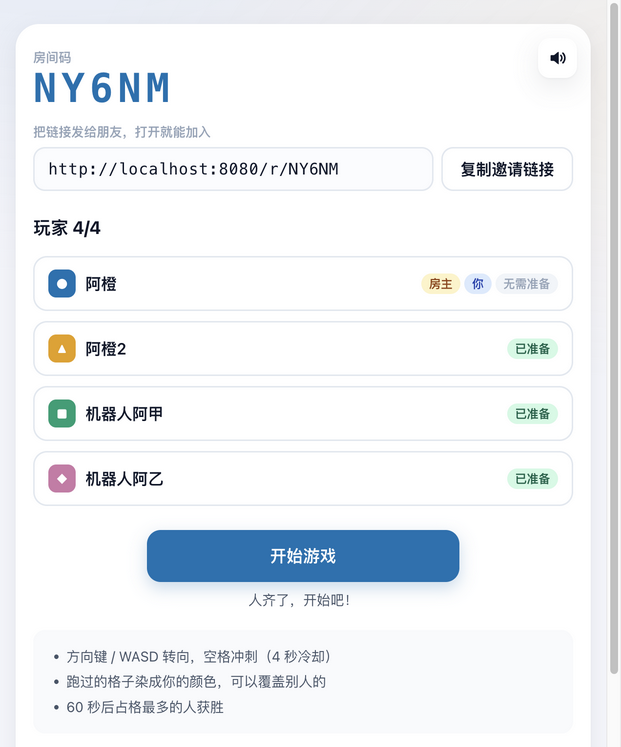
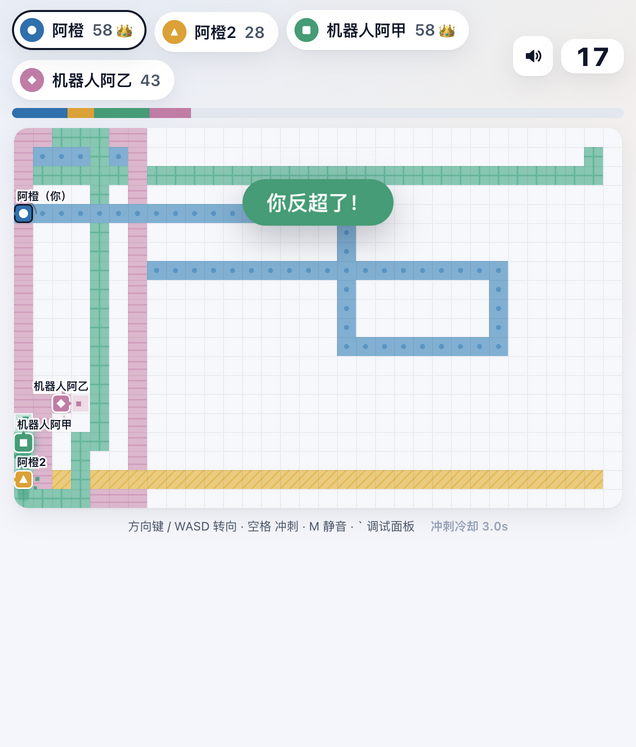
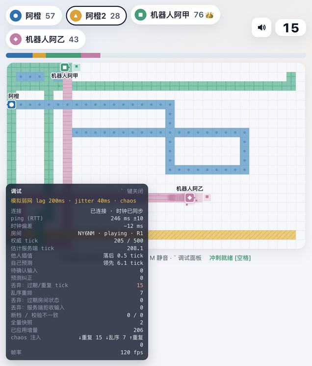

# 60 秒抢地盘 · Turf Rush

一个打开浏览器就能玩的 2–4 人实时联机游戏。每人控制一个色块在 32×20 的网格上前进，走过的格子染成自己的颜色，也可以覆盖别人的颜色；60 秒结束时占格最多的人获胜。不需要账号，创建房间后把链接发给朋友，对方打开链接、确认昵称就能进来。

**在线地址：<https://turf-rush-gw9p.onrender.com>**

代码仓库：<https://github.com/herman0609/turf-rush> · 全部功能与验证方法：[docs/功能说明.md](docs/功能说明.md) · 设计方案与取舍记录：[docs/DECISIONS.md](docs/DECISIONS.md)

<p>
  
  
  
</p>

更多截图在 [docs/screenshots](docs/screenshots)；开发分工、时间线和范围取舍见 [docs/开发过程与AI协作.md](docs/开发过程与AI协作.md)。

> 部署在 Render 免费实例上：15 分钟无人访问会休眠，休眠后第一次打开需要等待约 1 分钟冷启动。房间只保存在服务器内存里，服务重启或重新部署后房间会失效，页面会给出提示。

## 怎么玩

| 操作 | 键盘 | 手机触屏 |
|---|---|---|
| 转向 | 方向键或 WASD | 在棋盘上滑动（不抬手可以连续转弯） |
| 冲刺：0.6 秒内速度翻三倍，冷却 4 秒 | 空格 | 轻点棋盘，或点右下角「冲刺」按钮 |
| 静音 | M，或点右上角喇叭 | 点右上角喇叭 |
| 调试面板 | `` ` `` 键 | 在地址后加 `?debug=1` |

撞墙会停住，转向后继续前进。玩家之间可以互相穿过，没有碰撞。除了颜色，每名玩家还有不同的形状标记（圆、三角、方、菱形）、地块纹理和头顶昵称，色盲玩家也能区分。

## 两人验收步骤（约 5 分钟）

需要两个"玩家"：两台设备、两个浏览器，或者同一浏览器的两个普通标签页都可以（身份存在 sessionStorage，每个标签页是独立的玩家）。下面用 A、B 指代两个人。

**一、完整闭环**

1. A 打开在线地址。昵称是随机生成的，可以修改。点击「创建房间」，进入大厅，可以看到 5 位房间码和邀请链接。
2. A 点击「复制邀请链接」，把链接发给 B。B 打开链接，只需确认昵称并点击「加入」，就会出现在 A 的玩家列表里。也可以在首页输入房间码加入，大小写、空格都不影响。
3. B 点击「准备」。A 是房主，不需要准备；所有人都准备好后，A 的「开始游戏」按钮变为可用，点击它。
4. 双方同时看到 3-2-1 倒计时，自己的角色带有脉冲光圈。随后进入 60 秒对局：双方能实时看到对方移动和染色，顶部比分条实时变化。最后 10 秒计时器变红、出现心跳音，领先者变化时会弹出"反超"提示。
5. 时间到后先显示"时间到！"，然后弹出结算卡：胜者和格数一目了然，平局会明确写出"平局"，赢家那一侧还有彩带。
6. 双方点击「再来一局」，回到同一个大厅并自动处于准备状态，不需要重新分享链接。A 开始第二局。

**二、房间与玩家生命周期**

| 操作 | 预期结果 |
|---|---|
| 对局中 B 刷新页面 | 1–2 秒内自动回到原座位，状态完整恢复，可以继续操作；A 这边不会弹出掉线提示 |
| 对局中 B 在同一个标签页里打开别的网址（模拟掉线） | 约 1.5 秒后，A 看到"B 掉线，重连中 28s"，B 的角色原地停住、显示"掉线"标记；同时出现"在线玩家不足 2 人，Ns 后结束本局"。10 秒内 B 按浏览器的后退键回到房间，就会回到原座位继续玩；否则本局提前结束，结算页会写明原因 |
| 对局中 B 直接关闭标签页 | A 这边的表现同上。身份保存在该标签页的 sessionStorage 中，用 Ctrl/Cmd+Shift+T 恢复刚关闭的标签页，可以带着原身份回来；如果用新标签页打开邀请链接，则是一个新玩家，会先以观战身份进入 |
| 大厅中房主 A 点击「离开房间」 | A 立即被移出房间，房主移交给 B，B 收到"你现在是房主"的提示 |
| 对局进行中，第三个人 C 打开邀请链接 | C 看到"对局正在进行，你将先以观战身份进入，下一局自动加入"，点击「进入观战」后能看到实时画面；本局结束、回到大厅后，C 自动补位成为玩家 |
| 房间已有 4 名玩家时，再有人加入 | 明确提示"房间已满（4/4），你可以先观战，有空位时下一局自动加入" |
| 打开一个不存在的房间链接，例如 `/r/ZZZZZ` | 显示"房间不存在或已失效"，并提供「创建新房间」入口 |
| 昵称里填写 `` | 按纯文本原样显示，不会执行；超过 12 个字符的部分会被截断 |

**三、弱网表现（可选）**

在任意一方的地址后加上参数，例如 `https://turf-rush-gw9p.onrender.com/?lag=200&jitter=40`，然后照常建房或加入。带上这些参数时，调试面板会自动打开，参数在刷新后依然保留，但复制出去的邀请链接不带这些参数。

| 参数 | 作用 |
|---|---|
| `lag=200` | 在客户端额外附加 200 ms 往返延迟 |
| `jitter=40` | 额外附加随机抖动，消息顺序保持不变 |
| `chaos=1` | 故意注入重复和乱序的下行消息，以及重复的上行输入 |

在 `?lag=200` 下应该看到：自己按下方向键后立即转向，没有回弹，面板里"预测纠正"保持 0 或很少；对方的移动依然平滑。加上 `chaos=1` 后，"丢弃：过期/重复 tick"和"乱序重排"两项计数会上升，"断档 / 校验不一致"仍然是 0 / 0，说明重复的消息被丢弃、乱序的消息被重新排好，两端画面保持一致。

**四、只有一个人验收时**

用机器人凑人数。它们走的是和真人完全相同的公开协议：会自动准备、在对局中移动和冲刺、结算后自动再来一局，按 Ctrl+C 退出时会主动离开房间。

```bash
# 用免安装运行包（见下文"运行方式"），不需要 npm install：
node tools/bots.js 房间码 3                                          # 对本机 8080 端口的服务
node tools/bots.js 房间码 3 --url https://turf-rush-gw9p.onrender.com  # 对线上地址

# 或者在源码目录：
npm install
npm run bots -- 房间码 3 --url https://turf-rush-gw9p.onrender.com
```

房间码在大厅页顶部。机器人需要在房主点击「开始游戏」之前加入。

## 运行方式

**1. 在线地址**：直接打开 <https://turf-rush-gw9p.onrender.com>，什么都不用装。

**2. 免安装运行包**：适合线上地址打不开，或者希望在本机或局域网里验收的情况。提交的压缩包中 `app/` 目录就是运行包，也可以在源码目录运行 `npm run package` 生成到 `release/turf-rush-app/`。只需要 **Node.js 18 或更高版本**（已实测 18.20、20.20、22），不需要 `npm install`，也不需要联网。

```bash
cd app                       # 或 release/turf-rush-app
./start.sh                   # macOS / Linux；Windows 双击 start.bat；macOS 也可以双击 start.command
                             # 任何系统都可以直接运行：node server/dist/index.js
# 打开 http://localhost:8080 ，开两个普通标签页就是两名玩家
node tools/sim.js            # 可选：回归测试，自带一个临时服务，约 20 秒，最后一行显示"✅ 回归测试通过"
```

**3. 从源码运行**：需要 **Node.js 20.19 或更高版本**（Vite 8 的要求，推荐 22）。

```bash
npm install
npm start          # 构建前后端，并在 http://localhost:8080 同时提供页面和 WebSocket
```

开发模式下运行 `npm run dev`：服务端用 tsx watch 启动在 8080 端口，前端用 Vite 启动在 <http://localhost:5173>，`/api` 和 `/ws` 会被代理到服务端。

**局域网联机**：服务端监听所有网卡，同一 Wi-Fi 下的手机或其他电脑打开 `http://<本机IP>:8080` 就能加入。在大厅里复制的邀请链接用的是当前地址栏里的域名，所以要先用本机 IP 打开页面，再复制邀请链接发给别人。本机 IP 可以在 macOS 的"系统设置 → 网络"里查看，Windows 用 `ipconfig` 查看。第一次运行时，系统防火墙可能会询问是否允许 node 接受传入连接，请选择允许。

| 环境变量 | 默认值 | 说明 |
|---|---|---|
| `PORT` | `8080` | 监听端口 |
| `MATCH_SECONDS` | `60` | 每局时长（秒） |
| `TRUST_PROXY` | 未设置 | 设为 `1` 时，从 `X-Forwarded-For` 读取客户端 IP 用于限流；部署在反向代理后面时打开 |
| `ALLOWED_ORIGINS` | 空 | WebSocket 允许的额外 Origin，用逗号分隔；同源请求始终允许 |
| `NODE_ENV` | 未设置 | 设为 `production` 时，静态文件的元数据只在启动时读取一次；不设置时每次请求都重新读取，方便本地只重新构建、不重启服务 |

## 常见问题

| 现象 | 解决办法 |
|---|---|
| 在线地址打开很慢，或者先出现 Render 的加载页 | 免费实例休眠后冷启动约需 1 分钟，等待即可；也可以改用免安装运行包 |
| 启动时提示"端口 8080 已被占用" | 换一个端口：`PORT=8081 ./start.sh`（源码目录下 `PORT=8081 npm start`）；Windows 先执行 `set PORT=8081`，再运行 `start.bat` |
| `./start.sh` 提示 Permission denied | 解压工具丢失了可执行权限，改用 `sh start.sh` |
| macOS 双击 `start.command` 时提示"无法验证开发者" | 右键点击文件，选择"打开"；或者在终端中运行 `./start.sh` |
| 提示找不到 node，或 `node -v` 低于要求 | 到 <https://nodejs.org> 安装 LTS 版本。运行包需要 18 或更高，源码构建需要 20.19 或更高 |
| 两个标签页被识别成同一个人，有一个被顶替 | 用的是"复制标签页"，它会连同 sessionStorage 一起复制。请用普通的新标签页打开邀请链接 |
| 没有声音 | 浏览器要求先和页面交互一次，所以点一下或按一个键之后才会出声；另外检查右上角的喇叭图标是否处于静音，按 M 可以切换 |
| 局域网里的其他设备打不开页面 | 确认两台设备在同一网络，并且用本机 IP 而不是 localhost 打开；检查系统防火墙是否允许 node |
| 页面显示"服务器刚刚重启 · 房间已失效" | 服务重启或重新部署后，内存里的房间会丢失，属于预期行为，重新创建房间即可 |

## 测试

| 命令 | 内容 |
|---|---|
| `npm test` | 100 个单元测试和集成测试：规则引擎的确定性、协议 schema、房间状态机与生命周期、预测与目标 tick、乱序重排，以及真实 HTTP / WebSocket 下的安全和异常处理 |
| `npm run typecheck` | 对 shared、server、client、scripts 四个部分做类型检查 |
| `npm run sim` | 回归脚本：启动真实服务端，由机器人甲、乙通过 WebSocket 完整跑完两局，过程中覆盖作弊和重复输入、断线后用 token 重连、中途观战、观战者补位和房主移交，最后断言所有端的结算结果一致、各自重建的地图校验和与服务端一致，且没有 tick 缺口 |
| `npm run verify` | 依次执行以上全部步骤，再加上构建 |
| `SIM_URL=https://turf-rush-gw9p.onrender.com npm run sim` | 对线上部署跑同一套回归，作为冒烟测试；远程模式按线上的 60 秒对局等待，大约需要 2 分半 |
| `npm run package` | 构建并生成免安装运行包 `release/turf-rush-app/`（服务端、前端、`tools/bots.js`、`tools/sim.js` 和启动脚本） |

## 架构速览

```
shared/   协议类型、zod 校验、确定性规则引擎 step(state, inputs)（服务端模拟和客户端预测共用同一份）
server/   Node + ws：HTTP 静态资源、/api、/ws 共用一个端口；房间状态机、20 Hz tick、输入校验与限流
client/   Vite + Canvas 2D，不使用 UI 框架：同步核心、插值与预测、渲染、HUD、WebAudio 合成音效
scripts/  sim-match.ts（回归测试）、bots.ts（机器人）、package.mjs（生成免安装运行包）
```

- **服务端权威**：服务端以固定 20 Hz 推进模拟。客户端只发送 `{seq, tick?, dir | dash}` 形式的输入，不能上报位置、分数或结果。每条消息都经过 schema 校验，单条消息不超过 1 KB，每个连接每秒最多 20 条；seq 必须单调递增，重复或过期的输入会被丢弃并计数。
- **下行同步**：加入或重连时下发全量快照，之后每个 tick 下发一条增量（变化的格子加上所有玩家状态），每条都带有 `(round, tick)`。客户端丢弃旧的或重复的消息，对稍微超前的消息先排队重排，并定期用校验和比对，不一致时自动请求快照自愈。
- **延迟处理**：其他玩家的移动按服务端时间做插值；自己的操作在本地用同一份 `step()` 立即预测，输入带上"希望生效的 tick"，服务端会在那个 tick 应用它，所以在正常延迟下两边结果逐 tick 一致。倒计时用 ping 估算时钟偏差后显示，胜负只认服务端的判定。
- **生命周期**：身份是服务端发放的 playerId 和 reconnectToken，存在 sessionStorage 中。掉线后座位保留 30 秒；同一 token 建立新连接时，会顶替掉旧连接；对局中在线玩家不足 2 人超过 10 秒，本局提前结束；空房间 5 分钟后被清理。

完整的消息协议、状态机、每个生命周期事件的处理方式，以及 32 条关键取舍，都记录在 [docs/DECISIONS.md](docs/DECISIONS.md) 中。

## 已知限制

- 房间只保存在单个进程的内存里，不支持多实例。服务重启或重新部署后，所有房间都会失效，客户端会提示"服务器刚刚重启，房间已失效"。
- Render 免费实例会休眠，冷启动约需 1 分钟。服务器在新加坡，从中国大陆访问 `onrender.com` 时，速度和稳定性取决于当地网络。
- 触屏操作在桌面浏览器上只做了代码路径检查，请在真机上按"怎么玩"表格验证一遍。
- 在 Chrome 中使用"复制标签页"时，sessionStorage 会被一起复制，两个标签页因此共用同一个身份；后打开的那个会把先打开的顶替下线，被顶替的页面会提供「以新玩家加入」。测试多人时，请用普通的新标签页打开链接。
- 按设计没有做的内容：账号、排行榜、匹配、聊天、多服务器扩展。
